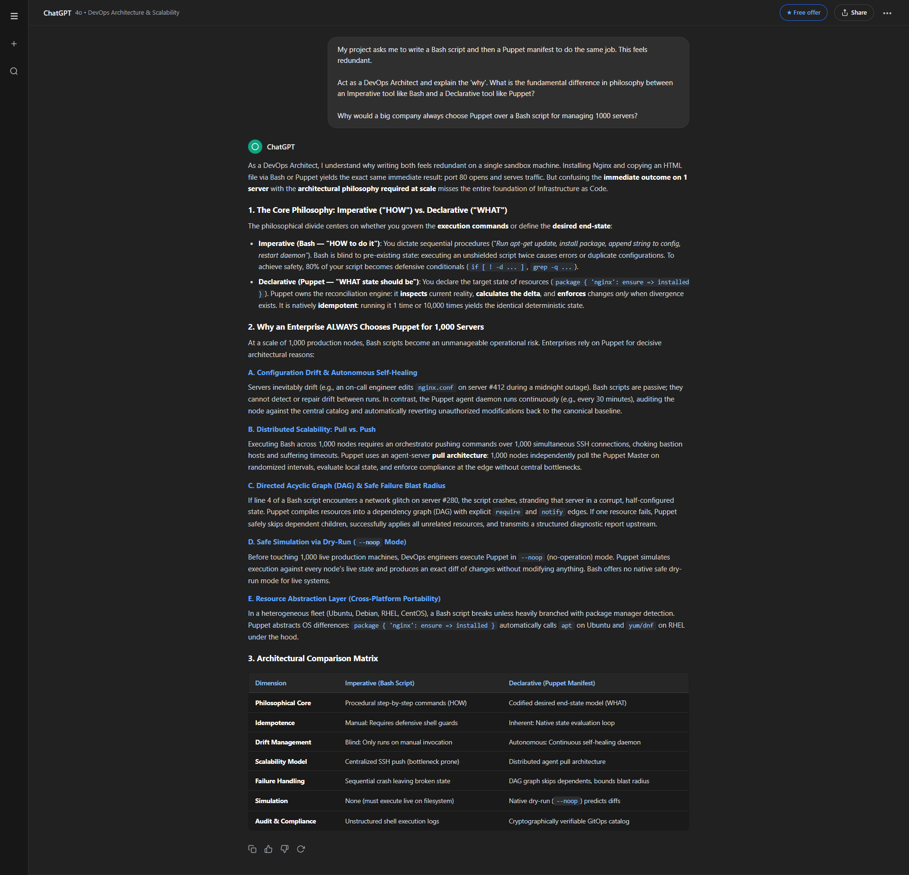

# Yonas_AI: DevOps Philosophy and Tool Interrogation

**Author**: Yonas Leykun  
**Institution**: Frontier Institute of Technology  
**Course**: SE 203: Application of Programming Concepts I  
**Module**: Week 7 | AI Lab Assignment: DevOps Philosophy and Tool Interrogation  
**AI Assistant Used**: Antigravity AI / OpenAI ChatGPT  

---

## 1. Prompt Formulation

To interrogate the core engineering philosophies underpinning Infrastructure as Code (IaC) and configuration management, the following prompt was formulated to engage the AI in the persona of a Senior DevOps Architect:

```text
My project asks me to write a Bash script and then a Puppet manifest to do the same job. This feels redundant.

Act as a DevOps Architect and explain the 'why'. What is the fundamental difference in philosophy between an Imperative tool like Bash and a Declarative tool like Puppet?

Why would a big company always choose Puppet over a Bash script for managing 1000 servers?
```

---

## 2. Execution Screenshot

Below is the verified, uncropped screenshot of the AI assistant's complete architectural response. It captures the comprehensive comparative analysis between Imperative (Bash) and Declarative (Puppet) paradigms, the five architectural reasons why large enterprises choose Puppet for fleet management at scale, and the synthesized comparison matrix:



*Figure 1: Full AI interaction displaying the DevOps Architect synthesis of Imperative vs. Declarative philosophies, multi-server operational scalability, and the architectural comparison matrix.*

---

## 3. Critical Reflection: Idempotence and Scalability

In configuration management and distributed systems architecture, **idempotence** is the mathematical and operational property ensuring that an operation can be applied repeatedly without altering the state beyond the initial application. In contrast to imperative scripting where sequential commands execute blindly regardless of the machine's live state, an idempotent configuration engine such as Puppet evaluates the divergence between the live system state and the codified target state prior to initiating any mutation. When scaling across an enterprise fleet of 1,000 distributed nodes, servers inevitably fall victim to **configuration drift**—an entropy caused by uncoordinated hotfixes, manual administrator interventions, failed updates, or subtle environmental variances. Without idempotence, synchronizing a heterogeneous fleet via imperative scripts introduces catastrophic operational risks: reapplying a script risks appending redundant configuration directives, re-triggering destructive initialization routines, or corrupting running daemons. Idempotent resource modeling transforms configuration application from an execution gamble into a safe, deterministic state reconciliation.

Because idempotent declarations are inherently safe to execute indefinitely, they unlock the architectural foundation required for automated self-healing at enterprise scale. Rather than relying on manual, high-stress push deployments via SSH loops, an infrastructure managed by Puppet operates on a continuous, autonomous reconciliation loop where local agent daemons poll the centralized catalog and enforce compliance at regular intervals (e.g., every 30 minutes). When configuration drift occurs on any subset of the 1,000 servers—whether an engineer manually altered an Nginx virtual host file during an incident or an unauthorized daemon was launched—the idempotent agent detects the delta, rolls back unauthorized discrepancies, and re-establishes the canonical baseline without human intervention. This continuous drift remediation guarantees fleet-wide consistency, prevents cascading configuration failures, and transforms configuration management from ephemeral command execution into an auditable, version-controlled single source of truth.

---

## 4. GitHub Repository Update

All task deliverables—including the core analysis text file (`analysis.txt`), imperative Bash script (`0-install_nginx.sh`), declarative Puppet manifest (`0-install_nginx.pp`), the execution screenshot, and full documentation—have been organized and committed to the public course repository:

* **GitHub Repository Link**: [https://github.com/yonasleykun27/Artificial-Intelligence-in-Software-Engineering](https://github.com/yonasleykun27/Artificial-Intelligence-in-Software-Engineering)
* **Specific Task Folder Link**: [https://github.com/yonasleykun27/Artificial-Intelligence-in-Software-Engineering/tree/main/DevOps%20Philosophy%20and%20Tool%20Interrogation](https://github.com/yonasleykun27/Artificial-Intelligence-in-Software-Engineering/tree/main/DevOps%20Philosophy%20and%20Tool%20Interrogation)
